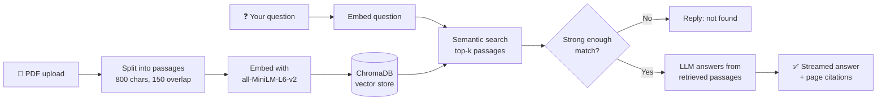

<h1 align="center">📚 StudyMate RAG</h1>

<p align="center">
  <b>Chat with your PDFs. Get answers backed by the exact pages they came from.</b>
</p>

<p align="center">
  
  
  
  
  
  
</p>

<p align="center">
  
" alt="StudyMate RAG screenshot" width="85%" />
</p>

---

## ✨ What is StudyMate?

StudyMate is a **Retrieval-Augmented Generation (RAG)** app for students. Upload lecture notes, a textbook chapter, or a research paper, then ask questions in plain English. Every answer is generated **only from your document**, and the app shows the pages and passages it used. If the answer isn't in the document, it tells you instead of making something up.

## 🚀 Features

| | Feature | What it does |
|---|---|---|
| ⚡ | **Streaming answers** | Responses appear word by word as the model writes them |
| 📍 | **Page citations** | Every answer lists the pages it came from |
| 🖍️ | **Highlighted sources** | Open the matching passages with your question's keywords highlighted |
| 💡 | **Suggested questions** | One-click starter questions generated from your document |
| 🎚️ | **Adjustable retrieval** | Sliders for how many passages to fetch and how strict the matching is |
| 🛡️ | **Hallucination guard** | Replies "not found" when the document doesn't contain the answer |
| 🔀 | **Multi-provider** | Switch between Groq, OpenAI, Gemini, and Mistral |
| 💾 | **Export chat** | Download your Q&A session as Markdown |

## 🧠 How it works



1. **Ingest:** `pypdf` reads the PDF page by page, and `RecursiveCharacterTextSplitter` cuts it into overlapping chunks while keeping each chunk's page number.
2. **Embed:** `all-MiniLM-L6-v2` (sentence-transformers) turns every chunk into a vector.
3. **Store:** vectors go into a ChromaDB collection that uses cosine similarity.
4. **Retrieve:** your question is embedded the same way, and the closest chunks are fetched.
5. **Guard:** if the best match is too weak, the app skips the LLM and says it couldn't find the answer.
6. **Generate:** a LangChain prompt tells the model to answer using only the retrieved context, at temperature 0.

## 🛠️ Tech stack

- **Language:** Python
- **UI:** Streamlit with custom CSS theme
- **Orchestration:** LangChain
- **Vector database:** ChromaDB
- **Embeddings:** sentence-transformers (`all-MiniLM-L6-v2`)
- **LLM APIs:** Groq, OpenAI, Google Gemini, Mistral
- **PDF parsing:** pypdf

## ⚡ Quick start

**1. Clone and enter the project**
```bash
git clone https://github.com/kaustubh2405-cpu/studymate-rag.git
cd studymate-rag
```

**2. Create a virtual environment and install packages**
```bash
python -m venv venv
venv\Scripts\activate          # Mac/Linux: source venv/bin/activate
pip install -r requirements.txt
```

**3. Add your API key**

Create a file named `.env` in the project folder with one line. Groq has a free tier at [console.groq.com](https://console.groq.com).
```
GROQ_API_KEY=your-key-here
```

**4. Run the app**
```bash
streamlit run app.py
```
Open http://localhost:8501, upload a PDF, click **Process PDF**, and start asking questions.

<details>
<summary><b>🔑 Using OpenAI, Gemini, or Mistral instead</b></summary>

<br />

Install the package for your provider, add its key to `.env`, then pick the provider in the sidebar.

| Provider | Install | `.env` key |
|---|---|---|
| OpenAI | `pip install langchain-openai` | `OPENAI_API_KEY` |
| Gemini | `pip install langchain-google-genai` | `GOOGLE_API_KEY` |
| Mistral | `pip install langchain-mistralai` | `MISTRAL_API_KEY` |

Optional settings:
```
LLM_MODEL=model-name     # override the default model if one is retired
MIN_SCORE=0.25           # default retrieval strictness
```
</details>

## 📊 Measure accuracy

Add questions about your PDF to `questions.json`, including a few the document can't answer:

```json
[
  {"q": "What is overfitting?", "expect": ["training data", "generalize"]},
  {"q": "Who won the 2018 World Cup?", "expect": "NOT_FOUND"}
]
```

Then run:
```bash
python evaluate.py your_notes.pdf questions.json
```
It prints a score such as `8/10 correct`.

## 📁 Project structure

```
studymate-rag/
├── app.py                 # Streamlit interface
├── rag.py                 # Chunking, embeddings, retrieval, LLM chain
├── evaluate.py            # Accuracy check against your own questions
├── questions.json         # Sample evaluation questions
├── requirements.txt
├── .streamlit/config.toml # Theme settings
└── .gitignore
```

## ⚠️ Limitations

- Scanned PDFs need OCR first, since the app reads text only.
- Tables and complex layouts may extract poorly.
- The vector store lives in memory, so it resets when the app restarts.
- AI answers can still be wrong, so check important details against the cited pages.

## 🗺️ Roadmap

- [ ] Hybrid search (BM25 + embeddings) and a reranker
- [ ] Multiple PDFs in one chat
- [ ] OCR support for scanned documents
- [ ] Persistent vector store
- [ ] Evaluation set with precision and recall

## 👤 Author

**Kaustubh Kumar**, final-year B.Tech Computer Science student building Generative AI applications.

[](https://github.com/kaustubh2405-cpu)
[](https://www.linkedin.com/in/kaustubh-kumar-57856a322)

<p align="center"><i>If this helped you, a ⭐ on the repo is appreciated.</i></p>
